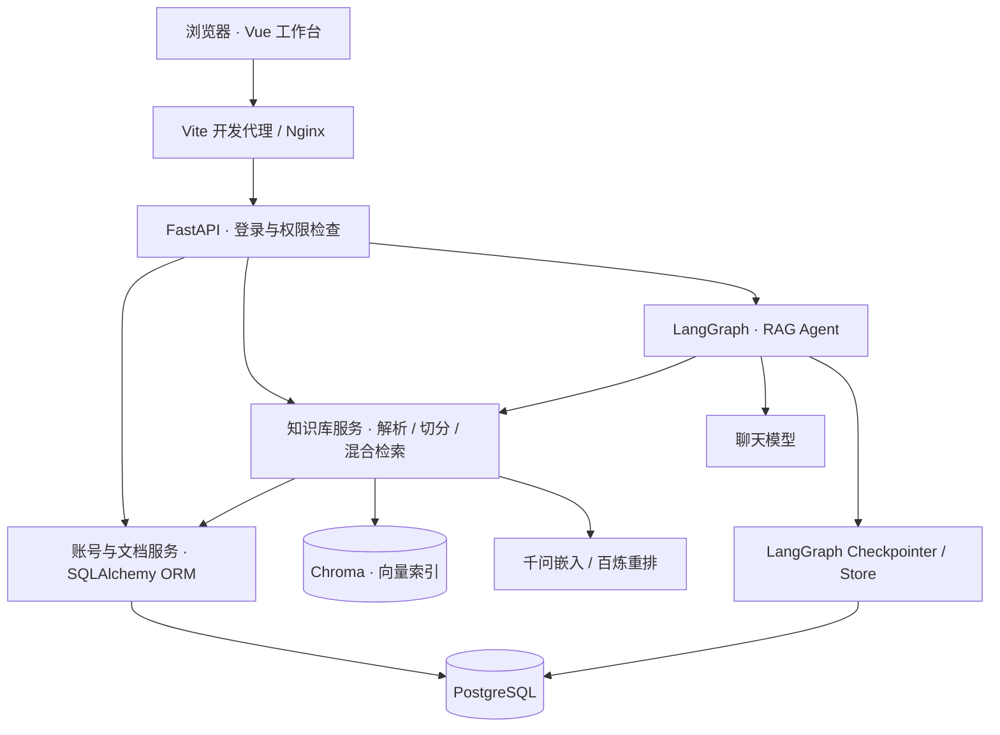

# 知页 · 私人知识库

一个可以上传文档、检索原文、带引用回答问题的个人知识库。前端使用 **Vue 3 + TypeScript + Vite**，后端使用 **FastAPI + LangGraph**，业务数据保存在 **PostgreSQL**，向量索引保存在 **Chroma**。

当前只保留 `rag-assistant`。这是在 Agent Service Toolkit 基础上持续改造的知识库项目，主入口已经由 Streamlit 改为 Vue 工作台。

## 能做什么

- **账号与数据隔离**：注册、登录、退出、修改密码；每个账号拥有自己的文档和会话。
- **文档管理**：上传 PDF、DOCX、UTF-8 TXT / Markdown，查看处理状态、版本与切分片段。
- **增量更新**：相同内容去重，支持为已有文档上传新版本、重建索引和删除。
- **混合检索**：向量召回与中文 BM25 关键词检索，通过 RRF 融合，再调用百炼文本重排。
- **知识问答**：基于检索证据生成回答，展示引用，点击后查看对应版本的原文片段。
- **检索验证**：直接查看召回结果、文档来源和排序分数，帮助理解 RAG 的实际行为。
- **会话持久化**：同一账号可以重新打开历史对话；服务重启后仍可读取已经保存的 checkpoint。

## 系统如何连接



**PostgreSQL 与 Chroma 分工不同**：前者保存账号、登录会话、文档、原文件、版本、正文片段和处理状态，后者保存用于相似度检索的向量索引。账号和文档通过 SQLAlchemy ORM 访问 PostgreSQL；LangGraph 的 checkpoint / Store 使用自己的持久化组件，并不经过这层 ORM。

聊天模型、嵌入模型、重排模型也相互独立。本项目可以使用 DeepSeek 回答问题、千问生成向量、百炼重排检索候选。更换聊天模型通常无需重建向量；更换嵌入模型则需要核对维度与索引兼容性。

## 本地启动

### 1. 准备环境

- Python 3.12–3.14，以及 `uv`。
- Node.js 22.12+，推荐使用 Node.js 24。
- 可连接的 PostgreSQL；下面使用 Docker Compose 启动数据库，也可以使用本机安装的 PostgreSQL。
- 聊天模型和嵌入 / 重排服务所需的 API Key。

以下命令均从仓库根目录开始执行，使用 Windows PowerShell。已有 `.env` 时继续使用原配置，不要覆盖。

```powershell
uv sync --frozen

# 仅首次配置时复制，然后手动填写
Copy-Item .env.example .env
```

### 2. 配置根目录 .env

下面是一组本地运行配置示例。将密钥占位符换成自己的值；数据库账号、密码需要与实际 PostgreSQL 保持一致。

```dotenv
HOST=127.0.0.1
PORT=8081
APP_URL=http://127.0.0.1:8502
APP_PORT=8502

USER_AUTH_ENABLED=true
AUTH_COOKIE_SECURE=false
AUTH_SESSION_DAYS=7
DATABASE_TYPE=postgres
POSTGRES_HOST=127.0.0.1
POSTGRES_PORT=5432
POSTGRES_USER=postgres
POSTGRES_PASSWORD=replace_with_your_database_password
POSTGRES_DB=agent_service

# 聊天模型：示例使用项目已支持的 DeepSeek
DEEPSEEK_API_KEY=your_deepseek_key
DEFAULT_MODEL=deepseek-v4-flash
USE_FAKE_MODEL=false

# 向量与重排：示例使用百炼北京地域
DASHSCOPE_API_KEY=your_dashscope_key
RAG_EMBEDDING_PROVIDER=dashscope
RAG_EMBEDDING_MODEL=text-embedding-v4
RAG_EMBEDDING_BASE_URL=https://dashscope.aliyuncs.com/compatible-mode/v1
RAG_RERANK_ENABLED=true
RAG_RERANK_MODEL=qwen3-rerank
RAG_CHROMA_PATH=./chroma_db
```

完整可选项见 [.env.example](.env.example)，切分、召回和重排配置见 [RAG 说明](docs/RAG_Assistant.md)。百炼密钥、模型权限与接口地域需要匹配。根目录示例文件保留了原模板的其他选项，启动新版私人知识库时仍需显式开启账号与 PostgreSQL，并选择嵌入服务。

模型密钥只放在后端 `.env`。前端不需要模型 API Key；不要把后端密钥复制到 `frontend` 或提交到 Git。

### 3. 启动数据库和后端

```powershell
docker compose up -d postgres
.\.venv\Scripts\python.exe src/run_service.py
```

数据库由 Docker 管理只是本地部署方式，Python 服务仍通过 PostgreSQL 的网络连接访问它。如果使用自行安装的 PostgreSQL，可跳过 Docker 命令，按实际地址填写连接配置。

### 4. 启动 Vue 前端

另开一个终端，进入仓库根目录后执行：

```powershell
cd frontend
npm ci
npm run dev
```

打开 **<http://127.0.0.1:8502>**，注册或使用已有账号登录。

| 地址 | 用途 |
| --- | --- |
| `http://127.0.0.1:8502` | 新版工作台：登录、聊天、文档与账号管理 |
| `http://127.0.0.1:8081/health` | 后端健康检查 |
| `http://127.0.0.1:8081/docs` | FastAPI 接口文档 |

前端将 `/api` 请求代理到 `http://127.0.0.1:8081`。后端端口不同时，在 `frontend/.env.local` 中配置 `API_PROXY_TARGET`，参考 [前端配置示例](frontend/.env.example)，然后重新启动前端。8502 被占用时应先停止旧前端；Vite 不会自动改用其他端口。

### 5. 体验一次完整流程

1. 登录后进入「我的文档」，上传一份资料。
2. 等待状态变为「已就绪」，点击「查看片段」检查解析后的正文。
3. 在「检索验证」中输入关键词或完整编号，核对命中的片段与来源。
4. 在「知识问答」中提问，点击回答下方的引用查看原文。
5. 从左侧重新打开历史对话，继续提问。

把文件放进 `data/` 不会自动导入。日常使用优先从页面上传；批量导入与旧索引迁移见 [RAG 说明](docs/RAG_Assistant.md#导入及旧索引迁移)。

## 使用 Docker 启动整个项目

先完成根目录 `.env` 配置，再执行：

```powershell
docker compose up -d --build
```

Compose 启动 `postgres`、`agent_service` 和 `web_frontend`。前端默认端口为 8502，可通过 `APP_PORT` 修改；容器版后端发布在宿主机 8080 端口，Nginx 在容器网络内代理 API。

如果本地 Vue 或旧 Streamlit 已占用 8502，先停止对应前端。升级时如果存在旧的 `streamlit_app` 容器，应先停止它，再启动 `web_frontend`。

持久化数据使用 `postgres_data` 和 `knowledge_data` 卷。宿主机本地模式使用的 `./chroma_db` 与容器卷是两个存储位置；已有本地数据切换为全容器部署前，需要备份并迁移，不能假定数据会自动复制。不要使用 `docker compose down -v` 清理日常运行环境。

## 代码从哪里看

```text
frontend/
  src/App.vue           页面与交互状态
  src/api.ts            Cookie 请求、错误提示、登录失效处理
  src/stream.ts         SSE 流式响应解析
  src/markdown.ts       Markdown 渲染与 HTML 清理
  src/types.ts          后端响应类型
  src/style.css         桌面与移动布局
  vite.config.ts        本地代理与开发端口
src/
  service/              FastAPI 路由、认证、聊天协议
  accounts/             SQLAlchemy 账号、登录会话与会话归属模型
  agents/               唯一 RAG Agent、工具与回答校验
  rag/                  文档 ORM 模型、文档服务、索引、混合检索与重排
  memory/               LangGraph checkpoint / Store
  core/                 配置与模型初始化
  schema/               API 数据结构
  client/               原 Python 客户端
scripts/manage_knowledge.py  指定账号的文档导入与旧索引迁移
docker/                 服务镜像与前端 Nginx 配置
```

前端只负责展示与调用接口，不直接连接数据库。用户身份由后端从登录 Cookie 中识别，前端不声明文档归属。新会话的 `thread_id` 由前端生成，用户 ID 则由账号机制稳定保存。

会话 checkpoint、知识库与个人长期记忆是不同概念：当前 RAG 使用文档知识库与会话 checkpoint；底层 Store 保留，但原研究助手的个人记忆工具已经移除，不会自动把聊天内容存成个人长期记忆。

## 验证

前端测试、类型检查和生产构建：

```powershell
cd frontend
npm test
npm run build
```

后端测试在仓库根目录执行，使用临时数据库与测试账号：

```powershell
$env:USER_AUTH_ENABLED='false'
uv run pytest tests/rag tests/agents tests/service tests/client tests/core tests/schema
uv run ruff check src tests scripts
Remove-Item Env:USER_AUTH_ENABLED
```

这些单元测试不需要真实模型调用。旧 Streamlit 的 AppTest 位于 `tests/app`。`npm run preview` 仅预览静态构建，不提供开发 API 代理；完整本地体验请用 `npm run dev`，容器部署使用 Nginx。

## 当前边界与排查

| 情况 | 说明或处理方法 |
| --- | --- |
| 文档列表为空 | 先确认当前登录账号；不同账号的资料相互隔离 |
| 连接失败或 502 | 检查后端是否启动、8081 健康检查及前端代理地址 |
| 知识库或模型暂不可用 | 检查后端日志、数据库连接、服务密钥、模型权限和接口地域；页面不展示内部堆栈 |
| 导入失败 | 检查文件格式和内容；当前支持文本解析，不包含 OCR 流程 |
| 修改嵌入模型 | 重新建立兼容索引；向量维度变化时先切换索引目录并保留旧库备份 |
| 修改数据库密码后仍无法连接 | 已初始化的 PostgreSQL 卷不会因环境变量变化自动修改原数据库账号密码 |
| 点击「停止等待」 | 停止浏览器接收，不保证服务端任务取消；可稍后重新打开会话查看结果 |

当前使用本地 Chroma，按单后端服务进程运行，不要让多个进程同时写同一个索引目录。上传、解析与索引在请求内完成，尚无独立后台任务队列。管理 CLI 操作同一索引前，应先停止后端。

文档删除会停止检索并清理对应向量，数据库中的历史版本和原文件可能保留，不等于物理擦除。引用编号校验可以验证来源编号有效，不能自动证明回答每句话都被原文支持，仍需结合原文核对。

## 更多说明

- [前端实现、接口对应关系与启动说明](docs/Frontend.md)
- [RAG 数据流程、检索配置、版本管理与导入](docs/RAG_Assistant.md)
- [账号认证与会话归属](docs/Account_Login.md)

原 Streamlit 界面及后端独立管理页面仍保留作为兼容入口。新项目开发与体验以 Vue 工作台为主。

## 来源与许可

本项目基于 Joshua Carroll 的 [Agent Service Toolkit](https://github.com/JoshuaC215/agent-service-toolkit) 改造，保留原作者版权与 MIT 许可，详见 [LICENSE](LICENSE)。
